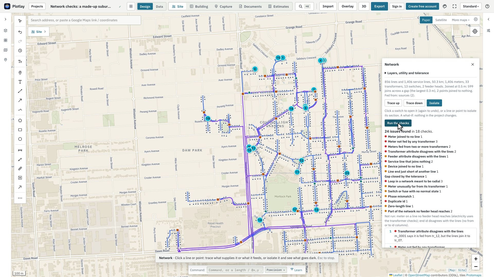

# Which meters hang off this transformer?

A utility network from a GIS export, joined up with a stated tolerance, traced up and down, isolated as a what-if and checked, in [Plotlay](https://www.getplotlay.com). First on a made-up electricity network with 15 faults planted in it, then on City of Gold Coast's open water data for Burleigh Heads. **Live version:** [getplotlay.com/showcase/network-checks](https://www.getplotlay.com/showcase/network-checks/)



- **24 of 24.** The checks flag 24 issues on the made-up network, and every one comes from one of the 15 planted faults. None is missed.
- **Trace down:** transformer tr_15 feeds 47 meters over 1.31 km of line. **Trace up:** meter m_0283 is fed from feeder FDR_CLG2 through tr_15.
- **Isolate:** opening recloser sw_hv02 takes supply from 93 meters; closing the normally open sw_hv01 could back-feed them from the other feeder.
- **Gold Coast water:** 3,025 mains and 5,507 service lines built into one network; isolating one main means closing three valves, with 43 properties inside.

[](https://app.plotlay.io/?example=network-checks)

## The made-up network

`data/made-up-network/` is an electricity network invented for this showcase and drawn along the real streets of Colonel Light Gardens in Adelaide (from OpenStreetMap). It describes nothing real.

| File | What |
|---|---|
| `feeder_heads.geojson` | 2 feeder heads, FDR_CLG1 and FDR_CLG2 |
| `hv_lines.geojson` | 11 kV lines (`ASSET_ID`, `TYPE`, `FEEDER`) |
| `transformers.geojson` | 33 transformers (`ASSET_ID`, `TYPE`, `KVA`, `FEEDER`) |
| `switches.geojson` | 13 switches: reclosers, the normally open point between the feeders, low voltage links (`NORMAL_STATE`) |
| `lv_lines.geojson` | low voltage mains (`PHASE`, `FEEDER`) |
| `service_lines.geojson` | a service line from the main to each meter (`PHASE`) |
| `meters.geojson` | 1,406 meters (`TRANSFORMER`, `PHASE`, `FEEDER`) |
| `planted.json` | the 15 faults planted, with the ids each one touches |

The faults are the kinds that turn up in real exports: a tie recorded closed, a tie with no state, a meter past the end of its service line, a service line short of its main, a main short of a corner (and one just inside the tolerance), meters naming the wrong transformer, a meter drawn 600 m out, a phase mismatch, a duplicated id, a zero-length line, a span labelled with the wrong feeder, a span drawn twice and a recloser off its line.

## The checks

`data/checks/` holds the lists from the Network panel's CSV and Excel buttons, for both networks: a row per issue with its number, check, severity, what was found, the ids and the latitude and longitude. They open in Power BI Desktop with Get data, Text/CSV or Excel workbook; the latitude and longitude go on a map visual.

On real data a flag is a place to look, not a fault proven on the ground. On the Gold Coast extract the checks found 156 groups of lines whose FROM_SAPID or TO_SAPID names an asset more than 2 m from the line's nearest end, 11 valves 2.1 m to 75 m from the nearest line, 10 main ends 0.62 m to 2.32 m short of another main, 10 pieces that no supply point reaches and 3 service lines that join nothing, plus 993 gaps of up to 0.5 m that the tolerance closed (information only).

## Rebuilt without Plotlay

`python/rebuild.py` rebuilds the made-up network from its GeoJSON with NetworkX and Shapely (ends and points joined within 0.5 m, tees split, high and low voltage meeting only at transformers, open switches cutting the network) and gets the same answers: tr_15 feeds 47 meters, m_0283 is fed from FDR_CLG2 through tr_15, and 93 meters lose supply when sw_hv02 opens. `python/network_checks.ipynb` runs it step by step and matches Plotlay's 24 issues to the planted faults.

```bash
python3 -m venv .venv && . .venv/bin/activate
pip install -r python/requirements.txt
cd python && jupyter nbconvert --to notebook --execute network_checks.ipynb
```

`scripts/download_gold_coast.py` downloads the Gold Coast data again (`data/gold-coast-burleigh/` is the copy used, from 24 November 2026; the City re-syncs its services nightly).

## Read it carefully

- The electricity network is made up; its streets are real.
- Results depend on the tolerance (0.5 m here). A larger tolerance joins more, and can join things that should stay apart.
- Gold Coast's valves carry no normal state in the open data, so every valve is taken as open.
- The Gold Coast extract is cut from a bigger network: lines running past its last valve or fitting are taken as supplied from outside it.
- Positions are as good as the GIS. Where law or a contract needs a licensed surveyor, their licence and sign-off are what count.

## Sources and licences

- Water and stormwater: City of Gold Coast open data, licensed under [CC BY 3.0 AU](https://creativecommons.org/licenses/by/3.0/au/) (water service connections [CC BY 4.0](https://creativecommons.org/licenses/by/4.0/)).
- Streets for the made-up network: © OpenStreetMap contributors, [ODbL](https://opendatacommons.org/licenses/odbl/).
- Code: MIT (`LICENSE`). The made-up network, the check lists and the pictures: CC BY 4.0 (`LICENSE-DATA`). See `NOTICE`.
